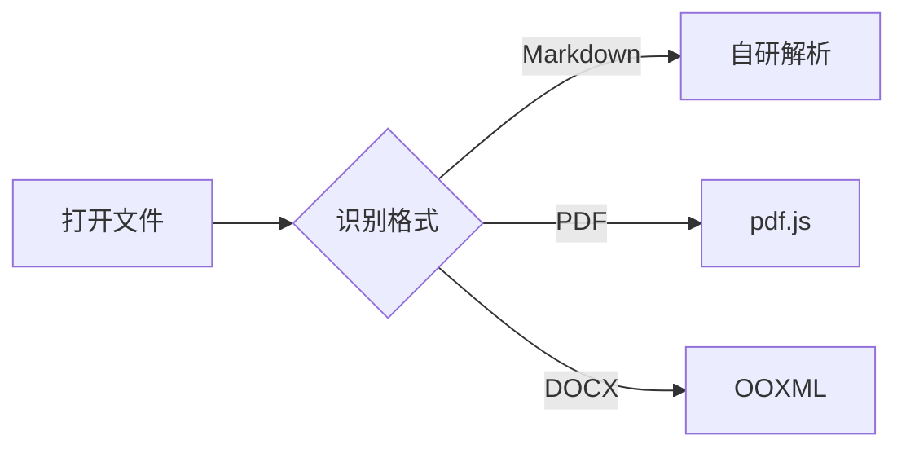

# OmniReader Markdown 测试文档

这是一段中文正文，用于验证 **粗体**、*斜体*、`行内代码`、~~删除线~~ 与 [外部链接](https://example.com)
以及[站内锚点](#第二章-结构与表格)是否正确渲染。

> 引用块：阅读器应当在浅色、深色与护眼主题下都保持可读性。

## 第二章 结构与表格

### 2.1 列表

- 无序列表项一
- 无序列表项二，包含 `inline code`
  - 嵌套列表项
1. 有序列表项一
2. 有序列表项二

- [x] 已完成任务
- [ ] 未完成任务

### 2.2 表格

| 格式 | 解析方式 | 定位锚点 |
| --- | --- | --- |
| Markdown | 自研解析器 | 标题 + 段落 |
| PDF | pdf.js | 页码 + 页内位置 |
| DOCX | OOXML 转换 | 段落序号 |
| EPUB | OPF + 导航 | 章节 + CFI |
| MOBI | PalmDOC + KF8 | 章节 + 字节偏移 |

### 2.3 代码

```js
export function progressOf(location) {
  const total = Math.max(1, location.chapters)
  return Math.min(1, Math.max(0, location.chapter / total))
}
```

### 2.4 公式

行内公式 $E = mc^2$，以及块级公式：

$$
\int_{0}^{\infty} e^{-x^2} dx = \frac{\sqrt{\pi}}{2}
$$

### 2.5 Mermaid



### 2.6 图片


## 第三章 长文滚动

段落占位文本。阅读器需要在长文档中保持滚动流畅，并在滚动时更新当前章节位置。
段落占位文本。阅读器需要在长文档中保持滚动流畅，并在滚动时更新当前章节位置。
段落占位文本。阅读器需要在长文档中保持滚动流畅，并在滚动时更新当前章节位置。

### 3.1 更多段落

段落占位文本 A。  
段落占位文本 B。  
段落占位文本 C。

## 第四章 结束

文档到此结束。
